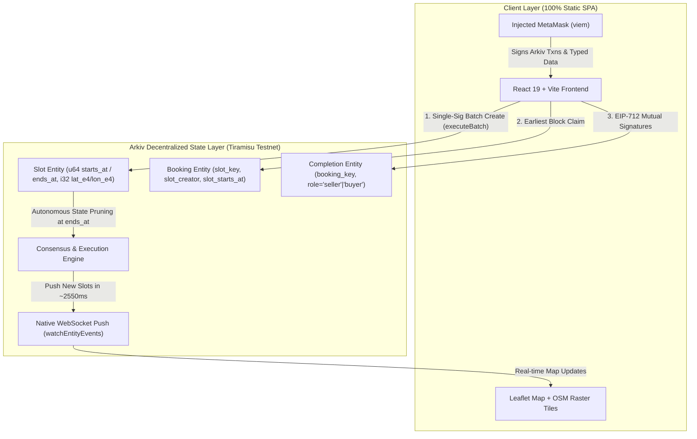

# SlotBazaar

[](https://opensource.org/licenses/MIT)
[-blue)](https://data.arkiv.network/?chain=tiramisu)
[](https://slotbazaar.vercel.app)

> **Live Deployed Application URL:** [https://slotbazaar.vercel.app](https://slotbazaar.vercel.app) *(Verified live on Vercel)*  
> **Source Repository:** [https://github.com/VivekGoudAdula/SlotBazaar](https://github.com/VivekGoudAdula/SlotBazaar)  
> Built for the **Arkiv Global Tour Stop Hackathon (9–18 October 2026)**.  
> Tracks: **Best Indian Use Case** & **Censorship Resistance**.

---

## 1. One-Paragraph Pitch

**SlotBazaar** is a decentralized, real-time discovery and reservation bazaar for perishable industrial capacity (machine tooling hours, intra-city freight trips, and freelance engineering sprints) across India’s manufacturing corridors. Powered entirely by **Arkiv Tiramisu**, SlotBazaar eliminates the 20–30% commission trap of centralized Web2 platforms. Time slots expire autonomously on-chain without background cron jobs, booking races are decided transparently by the earliest confirmed block, and two-sided cryptographic signatures generate verifiable, portable MSME reputation that cannot be unilaterally altered after consensus.

---

## 2. The Ravi and Meena Story

In the industrial corridors of **Jeedimetla (Hyderabad)**, **Ravi** operates a precision job-shop with two 4-axis CNC milling machines. Between major automotive part batches, his machines frequently sit idle for 2- to 4-hour gaps. Machinery depreciation and high fixed electrical tariff charges continue regardless of whether a spindle is turning.

Three kilometers away in Balanagar, **Meena** runs an assembly unit producing specialized water filtration systems. At 11:30 AM, her workshop’s primary die-cutting machine breaks down right before an urgent delivery deadline. Calling brokers means paying exorbitant 20% markups and waiting hours for responses.

With **SlotBazaar**:
1. Ravi opens SlotBazaar on his phone. Browser GPS verifies his Jeedimetla workshop. He selects *"Machine"*, enters *"CNC Milling Slot (2h available)"*, sets expiry for 2:30 PM, and signs with MetaMask for `< 0.0002 GLM`.
2. Meena opens the live interactive map with **zero login and no wallet required**. She instantly spots Ravi's slot.
3. Meena connects MetaMask and clicks **Book Slot**. Arkiv records her reservation entity.
4. When physical cutting finishes at 2:15 PM, both Ravi and Meena sign an EIP-712 job completion statement.
5. Arkiv verifies both cryptographic signatures, instantly unlocking a **🏆 1 Verified Job** reputation badge on Ravi's on-chain profile. Both businesses thrive without a centralized broker taking a cut.

---

## 3. Judges: Try This in 60 Seconds

Follow this exact path to evaluate SlotBazaar end-to-end:

1. **Browse with Zero Friction:** Open [https://slotbazaar.vercel.app](https://slotbazaar.vercel.app). Browse active industrial capacity across Jeedimetla, Surat, Tiruppur, Morbi, and Ludhiana without connecting a wallet.
2. **Inspect On-Chain Proofs:** Click any slot marker or list card. In the drawer, expand *"🔐 On-Chain Proof"* and click **Explorer ↗** to verify the raw decentralized entity on [data.arkiv.network](https://data.arkiv.network/?chain=tiramisu).
3. **Connect MetaMask:** Click **Connect Wallet** (top right). Accept the prompt to switch to **Arkiv Tiramisu testnet** (`chainId: 60138` / `0x761591`). Need testnet GLM? Claim free tokens from the [Arkiv Faucet](https://hub.arkiv.network/faucet).
4. **Post an Immutable Slot:** Click **+ Post a slot**. Your GPS coordinates and industrial hub are auto-detected. Submit your time window. Within **~2.5 seconds**, the new slot appears live on your screen and all open peer tabs via native Arkiv WebSocket streaming!
5. **Book from a Second Wallet:** Switch MetaMask to a second account. Click **Book Slot** to create an immutable on-chain reservation entity.
6. **Mutual EIP-712 Confirmation:** Open the slot drawer / *My Jobs* on both accounts and click **Confirm Job Completion**.
7. **Instant Verifiable Reputation:** Both signatures are cryptographically matched on-chain, immediately displaying the verified reputation badge (`🏆 1 Verified Job`) on the seller's card!

---

## 4. Architecture Diagram



---

## 5. Tech Stack

| Layer | Technology | Purpose |
|---|---|---|
| **Frontend Framework** | Vite 8 + React 19 + TypeScript | High-performance reactive web application |
| **Decentralized Database** | `@arkiv-network/sdk` v0.8.1 | State storage, numeric range queries, entity expiration |
| **Blockchain / EVM** | Arkiv Tiramisu Testnet (`chainId: 60138`) | Consensus, timestamp ordering, gas settlement |
| **EVM Primitives & Signing** | `viem` v2.57.4 | Account management, EIP-712 typed signing |
| **Mapping Engine** | Leaflet 1.9 + `leaflet.markercluster` | Interactive cluster mapping & geographic bounds |
| **Map Background Tiles** | OpenStreetMap Contributors (ODbL) | Lightweight spatial context cached via CDN |
| **Testing Harness** | `tsx` + custom pure unit test runners | 42 passing unit tests covering pagination & reputation rules |

---

## 6. Setup and Local Execution

### Prerequisites
* Node.js 20+ and npm 10+
* MetaMask browser extension installed
* Testnet GLM from [Arkiv Faucet](https://hub.arkiv.network/faucet)

### Installation
```bash
git clone https://github.com/VivekGoudAdula/SlotBazaar.git
cd SlotBazaar/APP
npm install
```

### Environment Configuration
```bash
cp .env.example .env
# Paste your testnet private key (used ONLY for CLI scripts, never bundled into web build)
# PRIVATE_KEY=0x<your-tiramisu-test-key>
```

### Run Locally
```bash
npm run dev
# Open http://localhost:5173
```

### Seeding Live Demo Data
```bash
# Preview seed plan (dry run)
npm run seed -- --dry-run

# Seed 40 synthetic slots across Indian clusters with mixed durations (up to 7 days)
npm run seed -- --long --count 40 --yes
```

### Automated Testing & Security Verification
```bash
# Run all pure unit test suites (Phase 4 & Phase 5)
npm run test:unit

# Scan repository and git history for private key leaks
npm run scan:secrets

# Production build check
npm run build
```

---

## 7. Map Tile Attribution

Map background tiles are served by [OpenStreetMap](https://www.openstreetmap.org/) contributors under the Open Database License (ODbL).  
**Attribution:** `Map tiles © OpenStreetMap contributors (ODbL) · Powered by Arkiv Tiramisu`.

---

## 8. Honest Limitations & Protocol Notes

In adherence to Arkiv friction logging rules, we transparently disclose existing protocol limitations:

1. **Passive Entity Expiration Emits No EVM Event Log (`FR-017`):** Arkiv's execution engine prunes expired entities silently at the consensus timestamp boundary without emitting an event log. To maintain a real-time reactive UI, SlotBazaar implements a client-side 1-second ticker with a 4-second (1–2 block) margin that removes expired cards immediately without waiting for server sweeps.
2. **Testnet Sequencer Centralization:** Tiramisu testnet currently operates on a single sequencer node. Mainnet production will require decentralized validator sets to ensure resilience against localized outages.
3. **Public Unencrypted Data:** All entity payloads on Tiramisu are publicly readable. While appropriate for open B2B machinery and logistics discovery, confidential commercial terms require client-side zero-knowledge proofs or asymmetric encryption.
4. **Free Sybil Addresses on Testnet:** Creating new testnet wallets is virtually free. Two-sided reputation proves mutual agreement between two distinct cryptographic accounts; enterprise mainnet deployment would integrate economic staking or proof-of-humanity credentials.

### 8.1 Measured Browser RPC Network Load
*Measured on 2026-10-14 in headless Chrome against deployed URL `https://slotbazaar.vercel.app` (N=3 samples of 60 seconds each per state)*

| State | Minute 1 | Minute 2 | Minute 3 | Average Req/Min | Technical Note |
| :--- | :---: | :---: | :---: | :---: | :--- |
| **Foreground Idle (WebSocket Healthy)** | 76 | 121 | 96 | **97.7** | WS connection active + 4s chainhead polling + viem event listener |
| **Foreground Idle (WebSocket Blocked)** | 60 | 105 | 101 | **88.7** | Fallback to HTTP polling with 8s query timeout / backoff |
| **Tab Hidden (Backgrounded)** | 75 | 111 | 70 | **85.3** | Browser timer throttling active |

---

## 9. License & Repository

This project is open-source under the [MIT License](LICENSE).  
**Repository:** [https://github.com/VivekGoudAdula/SlotBazaar](https://github.com/VivekGoudAdula/SlotBazaar)  
© 2026 Vivek Goud Adula and SlotBazaar Contributors.
