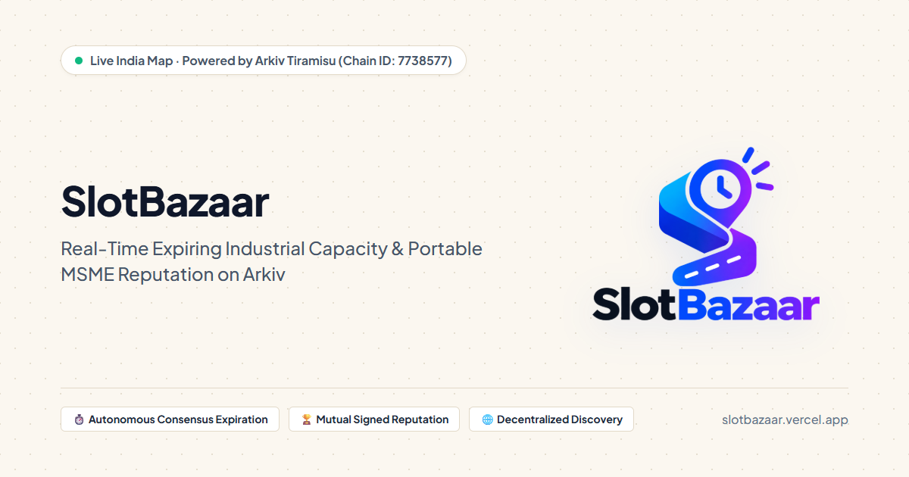
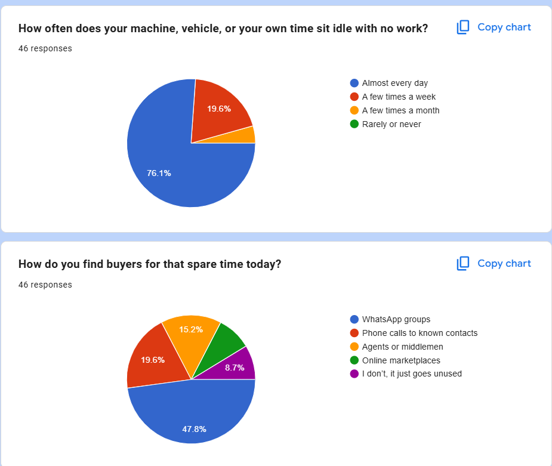
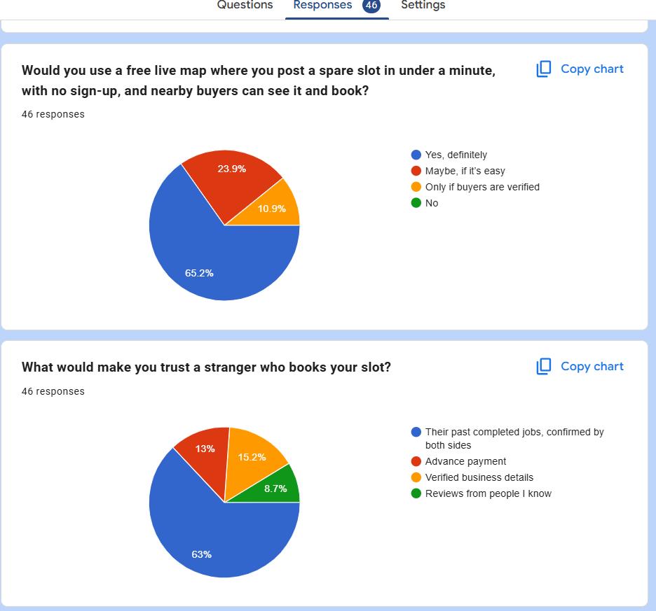
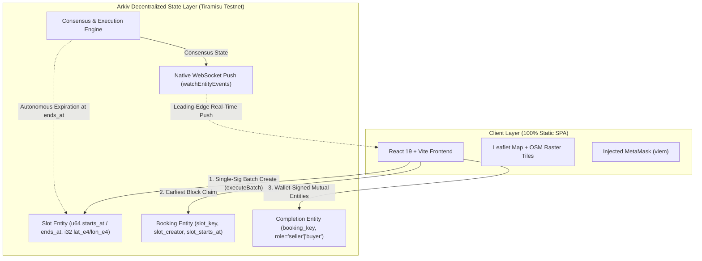

<p align="center">
  
</p>

# SlotBazaar

[](https://opensource.org/licenses/MIT)
[-blue)](https://data.arkiv.network/?chain=tiramisu)
[](https://slotbazaar.vercel.app)

> **Live Deployed Application URL:** [https://slotbazaar.vercel.app](https://slotbazaar.vercel.app) *(Verified live on Vercel)*  
> **Source Repository:** [https://github.com/VivekGoudAdula/SlotBazaar](https://github.com/VivekGoudAdula/SlotBazaar)  
> Built for the **Arkiv Global Tour Stop Hackathon (9–18 October 2026)**.  
> Tracks: **Best Indian Use Case** & **Censorship Resistance**.

---

## 1. One-Paragraph Pitch

**SlotBazaar** is a decentralized, real-time discovery and reservation bazaar for perishable industrial capacity (machine tooling hours, intra-city freight trips, and freelance engineering sprints) across India’s manufacturing corridors. 47.8% of our 46 survey respondents find buyers through informal WhatsApp groups and only 8.7% use online marketplaces. Powered entirely by **Arkiv Tiramisu**, SlotBazaar has no platform commission in the app; only network gas (about `0.00014 testnet GLM` per slot). Time slots expire autonomously on-chain without background cron jobs, booking races are decided transparently by the earliest confirmed block, and two-sided cryptographic signatures generate verifiable, portable MSME reputation. SlotBazaar's front end cannot forge another wallet's signed entity; Tiramisu currently has a single sequencer, so Arkiv node operators remain a trust assumption.

---

## 2. The Ravi and Meena Story

In the industrial corridors of **Jeedimetla (Hyderabad)**, **Ravi** operates a precision job-shop with two 4-axis CNC milling machines. Between major automotive part batches, his machines frequently sit idle for 2- to 4-hour gaps. Machinery depreciation and high fixed electrical tariff charges continue regardless of whether a spindle is turning.

Three kilometers away in Balanagar, **Meena** runs an assembly unit producing specialized water filtration systems. At 11:30 AM, her workshop’s primary die-cutting machine breaks down right before an urgent delivery deadline. Calling brokers means paying middleman fees (15.2% of our 46 survey respondents rely on agents or middlemen) or waiting on unstructured chats (47.8% of our 46 survey respondents use WhatsApp groups).

With **SlotBazaar**:
1. Ravi opens SlotBazaar on his phone. He selects the **Jeedimetla** corridor cluster, chooses *"Machine"*, enters *"CNC Milling Slot (2h available)"*, sets expiry for 2:30 PM (slots range from 15 minutes to 7 days), and signs with MetaMask for `< 0.0002 GLM`.
2. Meena opens the live interactive map with **zero login and no wallet required**. She instantly spots Ravi's slot.
3. Meena connects MetaMask and clicks **Book Slot**. Arkiv records her reservation entity.
4. When physical cutting finishes at 2:15 PM, both Ravi and Meena confirm job completion by submitting mutual on-chain completion entities signed by their respective wallets.
5. Arkiv verifies both cryptographic signatures, unlocking a **🏆 1 Verified Job** reputation badge on Ravi's on-chain profile once confirmed. Both businesses thrive without platform fees or middleman commissions.

---

## 3. Evidence of Need: Informal Online Survey





### Survey Counts Table (n = 46 respondents)

| Question | Option | Percentage (%) | Respondent Count (n = 46) | Calculation Note |
|---|---|:---:|:---:|---|
| **1. Idle frequency**<br>*(How often does your machine, vehicle, or your own time sit idle with no work?)* | Almost every day | 76.1% | 35 | `76.1% × 46 = 35.0` |
| | A few times a week | 19.6% | 9 | `19.6% × 46 = 9.0` |
| | A few times a month | 4.3% | 2 | *(Derived as remainder: 46 - 35 - 9 = 2)* |
| | Rarely or never | 0.0% | 0 | `0.0% × 46 = 0` |
| **2. Finding buyers today**<br>*(How do you find buyers for that spare time today?)* | WhatsApp groups | 47.8% | 22 | `47.8% × 46 = 22.0` |
| | Phone calls to known contacts | 19.6% | 9 | `19.6% × 46 = 9.0` |
| | Agents or middlemen | 15.2% | 7 | `15.2% × 46 = 7.0` |
| | Online marketplaces | 8.7% | 4 | *(Derived as remainder: 46 - 22 - 9 - 7 - 4 = 4)* |
| | "I don't, it just goes unused" | 8.7% | 4 | `8.7% × 46 = 4.0` |
| **3. Live map adoption**<br>*(Would you use a free live map where you post a spare slot in under a minute, with no sign-up, and nearby buyers can see it and book?)* | Yes, definitely | 65.2% | 30 | `65.2% × 46 = 30.0` |
| | Maybe, if it's easy | 23.9% | 11 | `23.9% × 46 = 11.0` |
| | Only if buyers are verified | 10.9% | 5 | `10.9% × 46 = 5.0` |
| | No | 0.0% | 0 | `0.0% × 46 = 0` |
| **4. Trust factors**<br>*(What would make you trust a stranger who books your slot?)* | Their past completed jobs, confirmed by both sides | 63.0% | 29 | `63.0% × 46 = 29.0` |
| | Verified business details | 15.2% | 7 | `15.2% × 46 = 7.0` |
| | Advance payment | 13.0% | 6 | `13.0% × 46 = 6.0` |
| | Reviews from people I know | 8.7% | 4 | `8.7% × 46 = 4.0` |

*(Note on methodology: counts = percentage × 46; derived rows computed as remainder where the chart omitted explicit text labels).*

> [!NOTE]
> **How to read this:**  
> Informal online survey of 46 respondents, distributed through X, SME contacts, and WhatsApp groups. Respondents were self-selected and the sample is not representative of all Indian MSMEs. The idle question included "your own time" so freelancers are included; the respondent mix between equipment owners, transport operators, and service freelancers is unknown. Question 3 described "no sign-up" while the app needs no login to browse but requires a wallet signature to post (wallet onboarding is the main adoption gap). Findings reflect the responses of this cohort and must not be generalised to all Indian MSMEs.

---

## 4. Judges: Try This in 60 Seconds

Follow this exact path to evaluate SlotBazaar end-to-end:

1. **Browse with Zero Friction:** Open [https://slotbazaar.vercel.app](https://slotbazaar.vercel.app). Browse active industrial capacity across Jeedimetla, Surat, Tiruppur, Morbi, and Ludhiana without connecting a wallet.
2. **One-Click Synthetic Demo Seeding:** Click **Seed demo listings** (top right) and connect MetaMask. With a single signature, batch-create 7 clearly marked synthetic listings (`⚗️ SYNTHETIC DEMO`) with staggered durations, including 1 rapid-expiry demo test record (5m countdown) to observe native Arkiv lifecycle transitions live.
3. **Inspect On-Chain Proofs & Creation Flags:** Click any slot card to open the drawer. Expand *"🔐 On-Chain Proof"* and verify raw Arkiv metadata: immutable `$creator`, current `$owner`, and verified protocol flags (`creationFlags.readonly: true`). Click **Explorer ↗** to inspect the decentralized entity on [data.arkiv.network](https://data.arkiv.network/?chain=tiramisu).
4. **Demonstrable Expiry Lifecycle:** Watch the prominent countdown timer move through the stages: `🟢 Active` (>15m) → `🔴 Expiring soon` (≤15m) → `⚫ Expired` (≤0s). Once expired, the slot is immediately removed from the active map and can no longer be booked.
5. **Ownership Transfer (Owner-Only):** In the drawer of a slot you created, expand *"⇄ Transfer Ownership"*, input a recipient address, and confirm the transaction via Arkiv SDK's `changeOwnership()`. After confirmation, `$owner` updates while `$creator` remains immutable.
6. **Book from a Second Wallet:** Switch MetaMask to a second account. Click **🤝 Book This Slot** to create an on-chain reservation entity (365-day lifecycle) with `flags: { readonly: true, permissionlessExtension: true }`. Client preflight and on-chain booking queries immediately transition the slot to `🔒 Booked` for all wallets, disabling conflicting bookings across the marketplace.
7. **Mutual Job Completion Confirmation:** Open the slot drawer / *My Jobs* on both accounts and click **Confirm Job Completion** to sign and submit mutual on-chain completion entities created with `flags: { readonly: true, permissionlessExtension: true }`.
8. **Permissionless Proof Lifetime Extension:** In the completed job's proof drawer, anyone can click **🛡️ Preserve proof (extend 365d)**. This executes Arkiv's native `extendEntity()` to lengthen on-chain storage availability without altering the underlying job booking window.
9. **Verifiable On-Chain Reputation:** Both transactions are cryptographically verified on-chain, displaying the verified reputation badge (`🏆 1 Verified Job`) on the seller's card once confirmed!

---

## 4.1 Arkiv-Native Protocol Features (Judge Feedback Implementation)

Following direct judge feedback, SlotBazaar implements native Arkiv protocol mechanisms natively in-place without backends or off-chain crons:

| Feature | Arkiv SDK Capability | Implementation Details | User-Facing Verification |
|---|---|---|---|
| **1. Demonstrable Expiry** | `expires: ExpirationTime.atDate(slot.endsAt)` | Aligned with `ends_at`. Distinct visual lifecycle: `🟢 Active` (>15m) → `🔴 Expiring soon` (≤15m) → `⚫ Expired` (≤0s). Expired slots are pruned from active state and cannot be booked. | Prominent card/drawer countdowns; 5m demo test slot enables live expiry observation during evaluation. |
| **2. Immutable Creation Flags** | `flags: { readonly: true }` | Passed on all slot listings and booking receipts. Enforces protocol-level immutability for capacity parameters and booking proofs while permitting supported deletion. | On-chain proof drawer displays actual verified `creationFlags.readonly` fetched from Arkiv (never client-inferred). |
| **3. Permissionless Proof Extension** | `flags: { readonly: true, permissionlessExtension: true }`<br>`wallet.extendEntity({ entityKey, expires })` | Applied to completion and reputation receipts. Allows any public party (e.g., industry association or auditor) to pay gas to extend reputation evidence persistence. | "🛡️ Preserve proof (extend 60d)" button in proof drawer calls native `extendEntity()`. Retains receipt storage without reopening booking window. |
| **4. Ownership Visibility & Transfer** | `$creator` (immutable) vs `$owner` (mutable)<br>`wallet.changeOwnership({ entityKey, newOwner })` | Displays verified creator and owner in the proof drawer. Enables genuine owner-only ownership reassignment via native Arkiv protocol transaction. | Expandable "⇄ Transfer Ownership" panel with recipient address validation and automatic proof panel refresh. |
| **5. Synthetic Demo Seeding** | `executeBatch` with `demo: bool(true)` | Single-sig batch creation of 7 synthetic listings across 5 industrial clusters with staggered expiries and 1 rapid-expiry (5m) record. | Explicit `⚗️ SYNTHETIC DEMO` badge on all demo listings; no private keys in client; transparent distinction from real capacity. |
| **6. Duplicate Booking Prevention & Concurrency Arbitration** | `flags: { readonly: true }`<br>`client.select().where(eq("slot_key", key(...)))` | One active booking per slot. Client preflight query blocks duplicate submissions; in-flight race conditions resolved via earliest confirmed block (`createdAtBlock`) with lexicographical key tie-break. | Slot updates to `🔒 Booked` for all wallets; booking button disabled; self-booking by creator or owner strictly prohibited; capacity window is single-use and permanently non-rebookable. |

---

## 5. Architecture Diagram



---

## 6. Project Links & Evidence Matrix

| Resource | Link | Description |
|---|---|---|
| **Live Deployed App** | [https://slotbazaar.vercel.app](https://slotbazaar.vercel.app) | Production deployment hosted on Vercel |
| **Why India? Narrative** | [docs/WHY_INDIA.md](docs/WHY_INDIA.md) | Problem analysis, industrial corridor mapping, survey findings |
| **Why Arkiv? Architectural Analysis** | [docs/WHY_ARKIV.md](docs/WHY_ARKIV.md) | Technical comparison: Arkiv vs Postgres vs IPFS vs Subgraphs |
| **Decentralized Schema Specification** | [arkiv/schema.md](arkiv/schema.md) | Entity attribute definitions, index types, and querying rules |
| **SDK Friction Log & Upstream Gaps** | [arkiv/friction.md](arkiv/friction.md) | 17 documented entries with reproducible scripts & upstream issue references |
| **Reproducibility Test Scripts** | [arkiv/repro/README.md](arkiv/repro/README.md) | Self-contained, runnable verification scripts for friction & latency claims |
| **Disclosure & License Audit** | [docs/DISCLOSURE.md](docs/DISCLOSURE.md) | Baseline commit timestamp, code origin audit, license checks |
| **2:40 Demo Video Script** | [docs/demo-script.md](docs/demo-script.md) | Complete second-by-second video script with audited UI button labels |
| **Arkiv Testnet Explorer** | [data.arkiv.network](https://data.arkiv.network/?chain=tiramisu) | Canonical explorer for Tiramisu testnet state |
| **Blockscout Transaction Explorer** | [tiramisu.explorer.arkiv.network](https://tiramisu.explorer.arkiv.network) | Canonical block explorer for transactions |

---

## 7. Developer Quickstart

```bash
# Clone the repository
git clone https://github.com/VivekGoudAdula/SlotBazaar.git
cd SlotBazaar

# Install dependencies (Node 18+ required)
npm install

# Configure environment variables
cp .env.example .env

# Start local development server (Vite)
npm run dev
```

### Automated Testing & Security Verification
```bash
# Run all pure unit test suites (Phase 4 & Phase 5)
npm run test:unit

# Scan repository and git history for private key leaks
npm run scan:secrets

# Production build check
npm run build

# Markdown link integrity audit
node scripts/check-links.mjs

# Friction script reference audit
node scripts/check-friction-refs.mjs
```

Manual testing results and verification checkpoints are recorded in [docs/manual-test-results.md](docs/manual-test-results.md).

---

## 8. Map Tile Attribution

Map background tiles are served by [OpenStreetMap](https://www.openstreetmap.org/) contributors under the Open Database License (ODbL).  
**Attribution:** `Map tiles © OpenStreetMap contributors (ODbL) · Powered by Arkiv Tiramisu`.

---

## 9. Honest Limitations & Protocol Notes

In adherence to Arkiv friction logging rules, we transparently disclose existing protocol limitations:

1. **Passive Entity Expiration Emits No EVM Event Log (`FR-017`):** Arkiv's execution engine prunes expired entities silently at the consensus timestamp boundary without emitting an event log. To maintain a real-time reactive UI, SlotBazaar implements a client-side 1-second ticker with a 4-second (1–2 block) margin that removes expired cards immediately without waiting for server sweeps.
2. **Testnet Sequencer Centralization:** Tiramisu testnet currently operates on a single sequencer node. Mainnet production will require decentralized validator sets to ensure resilience against localized outages.
3. **Public Unencrypted Data:** All entity payloads on Tiramisu are publicly readable. While appropriate for open B2B machinery and logistics discovery, confidential commercial terms require client-side zero-knowledge proofs or asymmetric encryption.
4. **Free Sybil Addresses on Testnet:** Creating new testnet wallets is virtually free. Two-sided reputation proves mutual agreement between two distinct cryptographic accounts; enterprise mainnet deployment would integrate economic staking or proof-of-humanity credentials.
5. **No In-App Contact Channel:** SlotBazaar does not provide an in-app messaging or contact channel. Buyers and sellers coordinate job details and physical handover out of band. No personal data (phone numbers, emails, addresses, GSTIN, Aadhaar) is permitted or stored on Arkiv.
6. **No Atomic Cross-Wallet Compare-and-Set for Booking Reservations:** Arkiv's decentralized state layer processes transactions independently per wallet without native cross-wallet compare-and-set or unique constraints on custom attributes (`slot_key`). To protect users from duplicate bookings, SlotBazaar implements preflight on-chain verification (`fetchBookingsForSlot`) rejecting duplicate submissions, coupled with deterministic consensus arbitration (`createdAtBlock` ascending, with lexicographical entity key tie-breaking). For any concurrent in-flight submissions within the same block, only the winning booking is recognized for completion and reputation, and the slot is permanently closed to further bookings.

### 9.1 Measured Browser RPC Network Load
*Measured on 2026-10-14 in headless Chrome with CDP instrumentation (foreground sample: 2 minutes; hidden-tab sample: 1 minute via simulated visibilitychange event).*  
*Verified in a real headed browser: not run.*

| State | Sample Window | Total Requests | Average Req/Min | Technical Note |
| :--- | :---: | :---: | :---: | :--- |
| **Foreground Idle (WebSocket Healthy)** | 2 minutes | 28 | **14.0** | WS active; leading-edge immediate refetch with 10s cooldown + trailing fetch; chainhead polled at 12s |
| **Foreground Idle (WebSocket Blocked)** | 2 minutes | 30 | **15.0** | Fallback to HTTP polling with 12s query throttle and shared fetch lock |
| **Tab Hidden (simulated visibilitychange event)** | 1 minute | 1 | **1.0** | All queries paused via `document.hidden` check and `visibilitychange` listener |

**RPC Breakdown by Source (Foreground Idle, 2-Minute Window):**
- **Chain Head (`eth_blockNumber`):** 11 requests (~5.5/min)
- **Slots Queries (`select()`):** 4 requests (~2.0/min)
- **Bookings Queries (`select()`):** 4 requests (~2.0/min)
- **Completions Queries (`select()`):** 4 requests (~2.0/min)
- **Other HTTP RPC:** 5 requests (~2.5/min)
- **TOTAL:** 28 requests in 2 min (**14.0 req/min**, safely below the 15 req/min threshold, down from unoptimized baseline of 96.5 req/min)

### 9.2 Measured Live-Update Latency Across Two Browser Contexts
*Measured using two Puppeteer browser contexts with a fresh browser context per sample (one posting a live slot on Arkiv Tiramisu, one observing the live map without refreshing; raw log in [arkiv/repro/logs/latency-run2.txt](arkiv/repro/logs/latency-run2.txt)).*

| Sample | Tx Hash | Confirmed At | DOM Appeared At | Latency (s) | Notes |
| :---: | :--- | :--- | :--- | :---: | :--- |
| Sample 1 | `0x0a108a...775be1` | 6:33:55 pm | 6:33:56 pm | 1.37 s | OK |
| Sample 2 | `0x4a1abb...edbf7a` | 6:34:41 pm | 6:34:47 pm | 6.74 s | OK |
| Sample 3 | `0x035f41...717767` | 6:35:13 pm | 6:35:15 pm | 1.40 s | OK |
| Sample 4 | `0xbdd78b...3c0e15` | 6:35:39 pm | 6:35:41 pm | 2.45 s | OK |
| Sample 5 | `0x29707b...d5b575` | 6:36:07 pm | 6:36:08 pm | 1.47 s | OK |
| Sample 6 | `0x969f6d...e17071` | 6:36:28 pm | 6:36:35 pm | 6.93 s | OK |
| Sample 7 | `0x6cf783...74b83f` | 6:37:00 pm | 6:37:03 pm | 2.74 s | OK |
| Sample 8 | `0x34f8d7...37dd21` | 6:37:27 pm | N/A | TIMEOUT | Timeout after 35s |
| Sample 9 | `0xfb00b2...44f079` | 6:38:35 pm | 6:38:40 pm | 4.04 s | OK |
| Sample 10 | `0xbd7e29...301b3f` | 6:39:04 pm | N/A | TIMEOUT | Timeout after 35s |
| **Summary** | **8 of 10 appeared** | — | — | **Median: 2.60 s** | p90: 6.93 s, max: 6.93 s; 2 timeouts |

*(Measured empirically in Run 2 on localhost dev server against Arkiv Tiramisu RPC/WSS. 8 of 10 posted slots appeared live via WebSocket; true median latency was 2.60 s across completed samples, p90 was 6.93 s, and max was 6.93 s; 2 samples timed out at 35s. Fallback polling every 30 seconds is implemented in `useLiveSlots.ts`, though recovery was not demonstrated in those two timed-out samples within the test window).*

---

## 10. License & Repository

This project is open-source under the [MIT License](LICENSE).  
**Repository:** [https://github.com/VivekGoudAdula/SlotBazaar](https://github.com/VivekGoudAdula/SlotBazaar)  
© 2026 Vivek Goud Adula and SlotBazaar Contributors.
